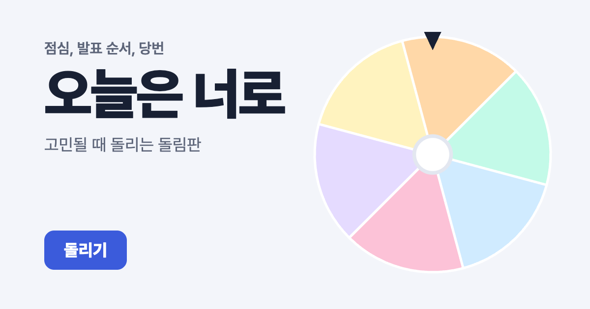

# 오늘은 너로: 배포하고 AI로 고쳐 보는 실습 저장소

점심 메뉴, 발표 순서, 이번 주 당번. 고민될 때 돌리는 돌림판이에요. 이미 다 만들어진 앱이라, 오늘은 이 앱을 **내 GitHub 저장소로 가져와 내 주소로 배포하고, AI와 함께 고쳐서 다시 배포**해요.



빌드 도구도, 서버도, API 키도 없는 정적 웹이에요. 그래서 무료로 배포되고, 어떤 AI 도구로든 고칠 수 있어요.

## 오늘 끝에 갖는 것

1. 내 GitHub 저장소 하나
2. 휴대폰에서 열리는 내 주소(`○○.vercel.app`)
3. AI로 고친 커밋 두 개와 `수정기록.md`
4. 다음에 고칠 것 한 줄

## 0. 강의 전에 (집에서 30분에서 1시간, 맥의 git 설치가 길 수 있어요)

| 할 일 | 어떻게 | 확인 |
|---|---|---|
| GitHub 가입 | github.com/signup. 지메일이 있으면 "Continue with Google"이 빨라요. 가입 중 메일 확인이 있어요. 가입 뒤 Settings › Emails에서 **Keep my email addresses private**를 켜요(웹에서 고친 기록에도 개인 메일이 남지 않게) | 로그인한 화면 오른쪽 위에 내 사진 |
| Vercel 가입 | vercel.com/signup에서 **Continue with GitHub** | Vercel 첫 화면이 열림 |
| AI 도구 하나 | 아래 둘 중 하나 | 첫 대화 한 번 |
| 노트북 | 가능하면 개인 노트북. 회사 노트북은 설치가 막히거나 회사망에서 GitHub이 막힐 수 있어요 | |
| 내 컴퓨터 준비 셋 | 아래 0-1 (AI 도구가 있는 사람만, 브라우저 편집기는 필요 없음) | git 숫자, GitHub 연결, 커밋 이름 |

AI 도구 두 갈래

| | Claude Code (유료) | Antigravity (무료) |
|---|---|---|
| 계정 | Claude Pro 이상 | 개인 지메일(회사, 학교 계정은 안 돼요), 만 18세 이상 |
| 설치 | 데스크톱 앱 또는 터미널 | Antigravity 앱 내려받기 |
| 한도 | 요금제 한도 | 주간 한도(다 쓰면 그 주는 끝, 그래서 작게 요청) |

둘 다 안 되면 **설치 없이 브라우저**로 와요: 브라우저 편집기(github.dev)와 무료 채팅 AI. 오늘 완료 기준까지 똑같이 갈 수 있어요(6절).

### 0-1. 내 컴퓨터 준비 셋 (AI에게 맡기고, 로그인만 내가)

시작 전에: 문서 폴더에 빈 폴더 `vibe-practice`를 만들고, AI 도구에서 그 폴더를 열어 시작해요(Claude Code 데스크톱 앱은 폴더를 고르면 시작, Antigravity는 파일 메뉴의 폴더 열기). 설치가 끝나면 **AI 도구를 껐다 켜요**(특히 윈도. 안 그러면 방금 깐 git이나 gh를 "찾을 수 없다"고 해요).

**터미널 창이란:** 맥은 '터미널' 앱(Spotlight에서 터미널), 윈도는 'PowerShell'(시작 메뉴에서 PowerShell). Antigravity는 위 메뉴 Terminal › New Terminal로 아래쪽에 터미널 칸이 열려요(메뉴 이름은 리허설에서 확인).

**① git.** AI 도구에 붙여 넣어요. 맥은 처음 git을 부르면 '명령줄 개발자 도구' 설치 창이 떠요. 설치를 누르고 끝날 때까지 기다려요(몇 분에서 수십 분). Windows는 Git for Windows를 깔아요.

```
내 컴퓨터에 git이 설치되어 있는지 확인해 주세요.
없으면 내 운영체제에 맞는 설치 방법을 한 단계씩 알려 주고,
설치가 끝나면 git --version으로 확인해 주세요.
설치 명령을 실행하기 전에는 무엇을 실행하는지 먼저 말해 주세요.
```

**② GitHub와 내 컴퓨터 연결.** 오늘 AI가 내 저장소에 고친 것을 올리려면 이 연결이 필요해요(GitHub는 git에 비밀번호를 받지 않아요).

```
GitHub CLI(gh)가 설치되어 있는지 확인하고, 없으면 설치해 주세요.
맥이면 Homebrew 없이 공식 zip을 받아 내 홈 폴더 아래(~/.local/bin)에 두고 PATH까지 잡아 주세요.
윈도면 winget에 약관 동의 옵션을 붙여 설치해 주세요.
설치 명령을 실행하기 전에 무엇을 실행하는지 먼저 말해 주세요.
로그인은 내가 직접 할 테니, 설치가 끝나면 내가 터미널에 칠 한 줄만 알려 주세요.
```

그다음 **로그인은 내가 직접** 터미널에 한 줄 쳐요(Antigravity는 아래쪽 터미널 칸, Claude Code는 터미널 창).

```
gh auth login --web --git-protocol https
```

묻는 말(git에도 이 로그인을 쓸까요)에는 Enter, 화면에 나온 8자리 코드를 복사하고 Enter를 누르면 브라우저가 열려요. 코드를 붙여 넣고 승인해요. 브라우저가 안 열리면 github.com/login/device를 직접 열어 코드를 넣어요. 그다음 AI에게 한 줄.

```
로그인했어요. gh auth status로 연결을 확인해 주세요.
```

**③ 커밋에 남는 이름과 메일.** 공개 저장소의 기록에는 메일이 남아요. 개인 메일 대신 GitHub가 주는 noreply 주소를 써요(GitHub › Settings › Emails, '...@users.noreply.github.com').

```
git 커밋에 쓸 이름과 메일을 이 컴퓨터 전체에 설정해 주세요.
이름은 내 GitHub 아이디 (여기에 아이디), 메일은 내 noreply 주소 (여기에 주소)로 해 주세요.
설정한 뒤 확인해서 보여 주세요.
```

## 1. 내 저장소 만들기 (템플릿에서)

1. 강의 템플릿 저장소 화면에서 **Use this template** › **Create a new repository**
2. Owner는 **내 개인 계정**, 이름은 `vibe-today-you`처럼 영어로, **Public**
3. **Create repository from template**

내 계정에 같은 파일이 든 저장소가 생겨요. 원본의 기록은 따라오지 않고 커밋 하나로 시작해요.

## 2. Vercel로 배포하기

1. vercel.com › **Add New** › **Project**
2. 방금 만든 `vibe-today-you` 옆 **Import**
3. Framework Preset은 **Other** 그대로, 다른 칸은 비워 두고 **Deploy**
4. 1분쯤 뒤 나온 주소를 휴대폰으로 열고, 옆 사람에게 보내요

- 프로젝트는 하나만 만들어요. 실패해서 다시 만들었다면 앞의 것은 Settings 맨 아래에서 지워요
- 저장소가 목록에 없으면 Import 화면의 "Adjust GitHub App Permissions"에서 이 저장소를 더해요

### 푸시하면 다시 배포돼요

GitHub에서 `data.js`를 열고 연필 아이콘 › 한 줄 바꾸기(예: `title: '오늘은 너로'`를 우리 팀 이름으로) › **Commit changes**. 1분 뒤 내 주소를 새로 고치면 바뀌어 있어요. Vercel은 GitHub에 올라온 커밋마다 새로 배포해요.

## 3. 내 컴퓨터로 가져오기

AI 도구에 그대로 붙여 넣어요. `내아이디`만 바꿔요. 복제가 끝나면 **그 폴더를 내가 직접 열어요**(Antigravity: 파일 메뉴의 폴더 열기로 vibe-practice/vibe-today-you, Claude Code 데스크톱 앱: 새 대화에서 그 폴더 고르기, 터미널: 그 폴더로 옮겨 claude 다시 실행). 그래야 AI가 그 폴더의 AGENTS.md, CLAUDE.md를 읽어요.

```
이 GitHub 저장소를 내 컴퓨터의 문서 폴더 아래 vibe-practice 폴더로 복제해 주세요.
https://github.com/내아이디/vibe-today-you
복제가 끝나면 폴더가 어디에 생겼는지와 파일 목록을 보여 주세요.
명령을 실행하기 전에 무엇을 실행하는지 먼저 말해 주세요.
```

공개 저장소라 가져오기에는 로그인이 필요 없어요. git이 없다고 나오면 0-1의 ①로.

## 4. 고치는 한 바퀴: 문제 한 줄 › 요청 › 확인 › 다시 배포

### 첫 요청: 읽고 설명부터

```
AGENTS.md와 docs/plan.md를 먼저 읽어 주세요.
아직 아무것도 고치지 말고, 이 앱이 무엇을 하는지,
내가 무언가 바꾸고 싶을 때 주로 어느 파일을 고치면 되는지 다섯 줄로 설명해 주세요.
```

### 첫 바퀴: 점심 목록을 우리 팀 것으로

화면에서 바꾸면 내 브라우저에만 남아요. data.js를 고쳐 배포하면 주소를 여는 모든 사람의 기본 목록이 바뀌어요. 그게 배포예요.

```
문제: 우리 팀은 점심 목록이 회사 근처 식당이 아니라서 점심때마다 항목을 지우고 다시 쓴다.
할 일: data.js의 점심 목록을 아래 여섯 곳으로 바꿔 주세요.
(식당 이름 여섯 개를 쉼표로)
하지 말 것: app.js와 style.css는 고치지 말고, 발표 순서와 당번 주제는 그대로 두세요.
끝난 기준: index.html을 새로 고치면 점심 탭에 여섯 곳이 보이고, 돌리기가 된다.
고치기 전에 무엇을 바꿀지 먼저 말해 주세요.
```

AI가 무엇을 바꿀지 말하면 읽어 보고 **"좋아요, 고쳐 주세요"**라고 답해요.

### 확인

```
index.html을 브라우저로 열어 주세요.
```

내 눈으로 직접 눌러 봐요. 돌리기, 빼고 돌리기, 주소 복사. 개발자 도구(F12)의 휴대폰 아이콘으로 좁은 화면도.

### 저장하고 다시 배포

```
방금 바꾼 것을 커밋하고 GitHub에 푸시해 주세요.
커밋 메시지는 한국어로, 무엇을 왜 바꿨는지 한 줄로 써 주세요.
비밀번호를 묻거나 멈추면 그대로 멈추고 나에게 알려 주세요.
```

1분 뒤 내 주소를 새로 고쳐요. 바뀌어 있으면 한 바퀴 끝.

### 두 번째 바퀴: 내가 고른 것 하나

먼저 문제 한 줄을 써요. "더 예쁘게"가 아니라 **누가, 언제, 무엇이 불편한가**.

```
문제: (누가, 언제, 무엇이 불편한가 한 줄)
할 일: (바라는 모습 한 줄)
하지 말 것: 외부 라이브러리를 더하지 말고, 요청에 없는 것은 바꾸지 마세요.
끝난 기준: (무엇을 눌러 보면 되는지)
먼저 어느 파일을 어떻게 바꿀지 계획을 세 줄로 보여 주고, 내가 좋다고 하면 고쳐 주세요.
```

계획을 읽고 괜찮으면 "좋아요, 고쳐 주세요", 이상하면 "이 부분은 이렇게 바꿔서 다시 계획해 주세요".

고를 거리

| 보기 | 크기 | 끝난 기준 예 |
|---|---|---|
| 소리 켜고 끄기 버튼(새로 고쳐도 기억) | 작음 | 버튼으로 끄고 새로 고쳐도 꺼져 있다 |
| 최근 결과를 결과 바로 아래로, 글자를 크게 | 작음 | 휴대폰에서 돌린 뒤 스크롤 없이 최근 결과가 보인다 |
| 첫 화면 색을 우리 팀 색으로 | 작음 | 바뀐 색이 보이고 글자가 잘 읽힌다(대비 4.5:1) |
| 항목별 무게(자주 나오게) | 중간 | 무게 3인 항목이 20번 중 더 자주 나온다 |

### 오류가 나면

```
아래 오류가 났어요. 원인을 한 줄로 설명하고, 고칠 방법을 먼저 말해 주세요.
(오류 문장을 그대로 붙여 넣기)
```

```
방금 고친 것을 마지막 커밋 상태로 되돌려 주세요.
되돌리기 전에 무엇이 사라지는지 먼저 알려 주세요.
```

## 5. 도구별로 갈리는 곳

1부부터 3부(배포)까지는 모두 브라우저로 같이 해요. 갈리는 곳은 강의 전 준비 셋과 4부의 세 군데예요.

| 단계 | Claude Code | Antigravity | 둘 다 막히면 |
|---|---|---|---|
| 준비 셋 | 0-1 요청문, 로그인 한 줄은 터미널 창에서 직접 | 같은 요청문, 로그인 한 줄은 아래쪽 터미널 칸에서 | 필요 없음 |
| ① 내 컴퓨터로 가져오기 | 3절 요청문 | 같은 요청문 | 저장소 화면에서 `.` 키(github.dev) |
| ② 고치기 | 4절 요청문 | 같은 요청문. 주간 한도라 작게 | 무료 채팅 AI에 data.js 전문과 요청문 |
| ③ 저장과 다시 배포 | "커밋하고 푸시해 주세요" | 같은 요청문, 또는 소스 제어 패널의 커밋과 동기화 | github.dev에서 커밋하면 곧 배포 |

맥락 파일: Claude Code는 `CLAUDE.md`, Antigravity는 `AGENTS.md`를 읽어요. 이 저장소는 규칙을 `AGENTS.md` 하나에 두고 `CLAUDE.md`가 그것을 불러와요.

## 6. 설치 없이 브라우저만으로

1. 내 저장소 화면에서 키보드 `.`을 누르면 브라우저 편집기(github.dev)가 열려요
2. `data.js`를 열어 전체를 복사해요
3. 무료 채팅 AI에 이렇게 보내요

```
아래는 data.js 전문이에요.
(붙여 넣기)
문제: (한 줄)
할 일: (한 줄)
고친 data.js 전문을 처음부터 끝까지 한 번에 주세요. 따옴표와 쉼표가 빠지지 않게 확인해 주세요.
```

4. 받은 전문으로 바꿔 넣고, 왼쪽 소스 제어 아이콘에서 메시지를 쓰고 Commit
5. 1분 뒤 내 주소를 새로 고쳐요

## 7. 막히는 곳

| 증상 | 원인 | 해결 |
|---|---|---|
| Vercel 주소가 404 | `index.html`이 저장소 맨 위가 아님 | 템플릿으로 만들었다면 생기지 않아요. zip으로 올렸다면 폴더 안의 파일을 맨 위로 |
| Vercel이 저장소를 못 찾음 | GitHub 앱 권한을 일부 저장소만 줌 | Import 화면의 "Adjust GitHub App Permissions" |
| 화면이 비어 있음 | data.js의 따옴표, 쉼표, 괄호가 빠짐 | 개발자 도구 콘솔의 빨간 줄이 몇 번째 줄인지 알려 줘요. 그 문장을 AI에게 |
| 고쳤는데 그대로 | 브라우저가 옛 파일을 기억, 또는 배포가 아직 | 강력 새로 고침(맥 Cmd+Shift+R, 윈도 Ctrl+F5), Vercel Deployments에서 끝났는지 |
| 푸시에서 멈추거나 비밀번호를 물음 | GitHub와 내 컴퓨터가 아직 연결 안 됨 | 0-1의 ②(gh 로그인 한 줄). 브라우저 창이 떴다면 뒤에 숨어 있지 않은지. 안 되면 브라우저 편집기로 커밋 |
| 푸시가 거절됨(rejected) | 브라우저 편집기로 먼저 커밋해서 GitHub 쪽이 앞서 있음 | AI에게 "GitHub에 있는 것을 먼저 받아서 합친 뒤 다시 푸시해 주세요." |
| 첫 커밋에서 이름을 모른다고 멈춤 | 커밋 이름과 메일이 없음 | 0-1의 ③ |
| Antigravity "not eligible" | 계정 자격(18세 이상, 개인 계정, 지역) | 개인 지메일로 다시, 안 되면 브라우저 편집기 |
| Antigravity 한도 | 주간 한도를 다 씀 | 브라우저 편집기. 다음부터는 작게, 한 번에 하나 |
| 회사 컴퓨터에서 github.com이 막힘 | 회사망 정책 | 휴대폰 핫스팟 |

## 확인 목록

- [ ] "돌리기"를 누르면 3초쯤 돌다 멈추고, 결과가 크게 나온다 ("샐러드로", "국밥으로"처럼 조사가 맞는다)
- [ ] "○○ 빼고 돌리기"를 누르면 그 항목 없이 다시 돈다
- [ ] 항목을 더하고 지우면 돌림판이 바로 바뀌고, 새로 고쳐도 남아 있다
- [ ] "주소 복사"로 받은 주소를 다른 창에서 열면 같은 돌림판으로 시작한다
- [ ] 휴대폰과 넓은 화면 모두 가로로 넘치는 곳이 없다

## 주의

- **Vercel 무료(Hobby)는 개인, 비상업 용도만이에요.** 내가 만들고 내가 쓰는 개인 프로젝트와 오늘 실습은 괜찮아요. 판매, 광고, 쿠폰, 제휴 링크는 안 되고, 회사 업무로 계속 쓸 도구라면 회사 계정과 유료 요금제나 회사가 정한 곳을 써요
- 결과는 브라우저 안에서 뽑아요. 경품 추첨처럼 이해관계가 걸린 곳에는 쓰지 않아요
- 사람 이름을 항목으로 넣고 주소를 보내면 이름이 주소에 그대로 담겨요
- 입력과 기록은 이 브라우저(localStorage)에만 남고, 어디로도 보내지 않아요. 바깥으로 나가는 요청은 글꼴뿐이에요

## 폴더

```
index.html  style.css  app.js  data.js  og.png  favicon.svg
AGENTS.md     AI 도구가 먼저 읽는 규칙과 맥락 (CLAUDE.md가 이 파일을 불러와요)
README.md     지금 읽는 설명서
수정기록.md    고칠 때마다 한 줄
docs/         plan.md(기획서), design.png(디자인 시안)
```
